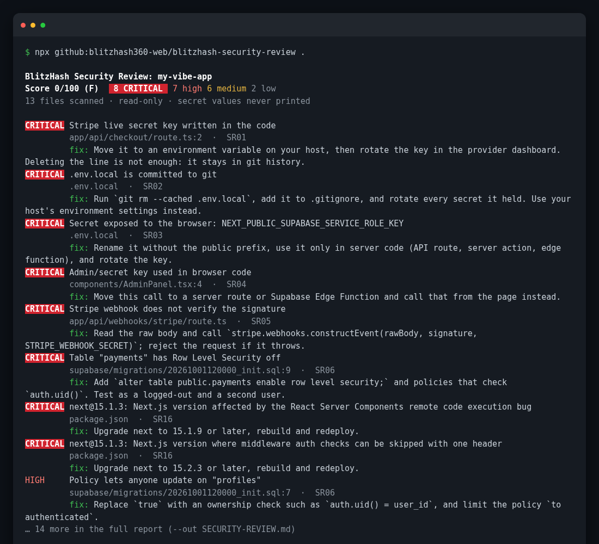

# BlitzHash Security Review

**Find the security holes in your AI-built app before someone else does: one command, plain-English report, ranked by how bad it is.**

[](https://github.com/blitzhash360-web/blitzhash-security-review/actions/workflows/ci.yml)
[](LICENSE)


Built your app with Lovable, Bolt, Replit, Cursor, v0 or Claude Code? The AI writes code that *works*, but it often leaves the same handful of doors open: keys in the code, tables without Row Level Security, webhooks anyone can fake, API routes with no login check. This tool reads your project, finds those mistakes, and tells you what each one means and how to fix it, without showing a single secret value.



## Quick start

```bash
# 1. In your project folder (Node 18+), see it on a deliberately insecure demo app first:
npx -y github:blitzhash360-web/blitzhash-security-review demo

# 2. Scan your own app and save the full report:
npx -y github:blitzhash360-web/blitzhash-security-review . --out SECURITY-REVIEW.md

# 3. Open SECURITY-REVIEW.md and fix the 🔴 Critical items first.
```

Prefer your AI agent to walk you through it? Install the skill (see [Agent skill](#agent-skill)) and ask: *"Run a security review of this app."*

## What it checks

| Check | What it looks for | Typical severity |
|---|---|---|
| `SR01` Secrets in code | Stripe, OpenAI, Anthropic, AWS, GitHub, Google, Slack, Resend keys, private keys, DB URLs with passwords, Supabase `service_role` JWTs (detected by the token's role claim) | Critical |
| `SR02` Committed `.env` | `.env` files tracked by git, or not covered by `.gitignore` | Critical / High |
| `SR03` Secrets sent to the browser | `NEXT_PUBLIC_`, `VITE_`, `EXPO_PUBLIC_`, `REACT_APP_`… variables that hold secret-looking values | Critical |
| `SR04` Admin keys in browser code | `service_role`, `auth.admin`, Stripe secret client in `'use client'` / SPA files | Critical |
| `SR05` Webhook signatures | Stripe webhooks without `constructEvent`; other webhooks with no signature check | Critical / High |
| `SR06` Database access rules | Supabase tables without RLS, `using (true)` write policies, world-readable tables, public buckets, open Firebase rules | Critical / High / Medium |
| `SR07` Injection | SQL built from template strings or concatenation, shell commands or `eval` from input | High |
| `SR08` XSS | `dangerouslySetInnerHTML`, `v-html`, `innerHTML` without a sanitizer | Medium |
| `SR09` Auth & sessions | API routes that change data with no auth check, JWTs decoded but not verified, session cookies without `httpOnly` | High / Medium |
| `SR10` Input validation | Request bodies used without a schema (zod, valibot, yup…) | Medium |
| `SR11` Rate limits | AI, email and login endpoints with no rate limiting anywhere | High |
| `SR12` CORS | `Access-Control-Allow-Origin: *`, especially with credentials | High / Medium |
| `SR13` Security headers | Missing CSP, HSTS, frame protection, `nosniff` | Medium / Low |
| `SR14` Open redirects | `redirect()` to a URL taken from the query string | Medium |
| `SR15` Error leaks | `error.stack` / `error.message` returned to clients | Low |
| `SR16` Dependencies | Built-in check for high-impact Next.js / React advisories (React2Shell CVE-2025-55182 / CVE-2025-66478, middleware bypass CVE-2025-29927), missing lockfile; `--audit` adds a full `npm audit` | Critical / Low |

Every finding comes with **where** (file and line), **why it matters** in one plain sentence, and **the fix**. See a full example: [examples/sample-report.md](examples/sample-report.md).

### Safe by design

- **Read-only.** It reads files and writes only the report you ask for.
- **Never prints secrets.** `.env` files are reduced to variable names the moment they're read; findings name the *kind* of key and its location, never the value. A test enforces this.
- **Offline by default.** No network calls unless you add `--audit`.
- **Zero dependencies.** Nothing to install but Node.

## Options

```text
security-review [path]              scan a project (default: current folder)
security-review demo                scan a built-in insecure demo app (fake keys)
security-review install-skill [dir] [--target claude|cursor|agents|all] [--yes]

--out FILE        write the full Markdown report
--md | --json     print the Markdown report or raw JSON
--fail-on LEVEL   exit 1 on any finding at LEVEL or worse (critical|high|medium|low)
--audit           also run `npm audit` (network, needs package-lock.json)
--ignore PATH     skip a folder (repeatable)
--no-git          don't ask git which files are committed
--no-color        plain output
```

Put `// security-review-ignore-file` in the first lines of a file to skip it (for intentional test fixtures).

## Use it in CI

Block pull requests that add a critical or high issue. Copy [examples/github-action/security-review.yml](examples/github-action/security-review.yml) into `.github/workflows/`:

```yaml
- run: npx -y github:blitzhash360-web/blitzhash-security-review . --out SECURITY-REVIEW.md --fail-on high
```

## Agent skill

The [`skills/security-review/SKILL.md`](skills/security-review/SKILL.md) skill teaches Claude Code, Cursor or any `AGENTS.md`-style agent to run the scan, confirm each finding, explain it in plain English and fix issues one at a time with your OK. It never repeats secret values and won't rewrite git history without a clear yes.

```bash
# Dry run: shows where it would write, writes nothing
npx -y github:blitzhash360-web/blitzhash-security-review install-skill .
# Install for Claude Code, Cursor and .agents
npx -y github:blitzhash360-web/blitzhash-security-review install-skill . --yes
```

## Going to production? What this doesn't cover

A scanner catches the common, obvious mistakes. It reads code, so it can't see:

- **Your live configuration:** RLS actually enabled in the production Supabase project, auth settings, which env vars are set on which deployment, public preview URLs.
- **Business-logic holes:** user A reading user B's invoice by changing an ID, a free plan reaching paid features, team/organization permissions.
- **Leaked-key cleanup:** rotating every exposed key and safely purging git history.
- **Edge protection:** WAF rules, bot protection, per-user spend caps on AI and email.
- **Resilience:** backups you've actually restored, monitoring and alerting, load and cost testing before a launch spike.

That's the work a senior engineer does by hand. **Want one to look at yours? Free assessment at [blitzhash.com](https://blitzhash.com).**

## More free tools from BlitzHash

- [blitzhash-launch-ready-check](https://github.com/blitzhash360-web/blitzhash-launch-ready-check): scan a *live URL* for headers, exposed files and launch basics.
- [supabase-rls-check](https://github.com/blitzhash360-web/supabase-rls-check): deep check of Supabase Row Level Security.
- [blitzhash-architecture-review](https://github.com/blitzhash360-web/blitzhash-architecture-review): plain-English architecture scorecard for AI-built apps.
- [blitzhash-vibe-coding-rules](https://github.com/blitzhash360-web/blitzhash-vibe-coding-rules): rules that make your AI write secure code by default.

## Credits

Original BlitzHash work, MIT licensed, no third-party code included. The checks follow public guidance from the [OWASP Top 10](https://owasp.org/www-project-top-ten/), [Supabase Row Level Security docs](https://supabase.com/docs/guides/database/postgres/row-level-security), [Stripe webhook signature docs](https://docs.stripe.com/webhooks#verify-events) and the [Next.js](https://nextjs.org/blog/CVE-2025-66478) and [React](https://react.dev/blog/2025/12/03/critical-security-vulnerability-in-react-server-components) security advisories. For deeper secret scanning across full git history, see [Gitleaks](https://github.com/gitleaks/gitleaks).

Checks are heuristics: they can miss things and occasionally flag something that's fine. Confirm each finding before acting on it. Issues and PRs with false positives/negatives are welcome.

## License

[MIT](LICENSE) © 2026 BlitzHash

---

**Built by BlitzHash: need a senior team to check or scale your AI-built app? Free assessment at https://blitzhash.com**
